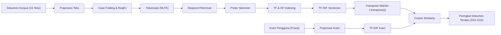

<div align="center">

# Automated Short Answer Grading (ASAG) Search Engine
### Tugas Pemrograman Kelompok II — Natural Language Processing (TI6073)

[](https://www.python.org/)
[](https://www.nltk.org/)
[](https://scikit-learn.org/)
[](https://streamlit.io/)

**Program Studi Informatika — Fakultas Teknologi Informasi**  
**Universitas Kristen Duta Wacana (UKDW), Yogyakarta**  
*Oktober 2026*

---

</div>

## 1. Anggota Kelompok

| No | NIM | Nama Lengkap | Alokasi Dokumen Korpus |
|:---:|:---:|:---|:---|
| 1 | **71231050** | **Samuel Natanael** | 5 Dokumen (`PDF/Sam/`) |
| 2 | **71241154** | **Indira Mai Narwastu** | 5 Dokumen (`PDF/Indira/`) |
| 3 | **71231021** | **Christian Nicholas Saputra** | 5 Dokumen (`PDF/NicSap/`) |

---

## 2. Alur Pemrosesan Teks (NLP Pipeline)



---

## 3. Struktur Berkas & Direktori

```text
├── PDF/                                     # Berkas PDF asli artikel ilmiah
│   ├── Indira/                              # 5 Berkas PDF anggota Indira
│   ├── Sam/                                 # 5 Berkas PDF anggota Samuel
│   └── NicSap/                              # 5 Berkas PDF anggota NicSap
├── corpus/                                  # 15 berkas hasil ekstraksi teks (.txt)
├── asag_search_engine.py                    # Skrip utama search engine (CLI & Streamlit)
├── README.txt                               # Dokumentasi resmi untuk pengumpulan E-Class (ZIP)
└── README.md                                # Dokumentasi visual untuk repositori GitHub
```

---

## 4. Daftar Dokumen Korpus & Sumber (15 Paper ASAG)

### Dokumen Indira Mai Narwastu
1. **A Hybrid Approach for Automated Short Answer Grading**  
   DOI: [https://doi.org/10.1109/ACCESS.2024.3420890](https://doi.org/10.1109/ACCESS.2024.3420890)
2. **Automated Short-Answer Grading using Semantic Similarity based on Word Embedding**  
   DOI: [https://doi.org/10.14716/ijtech.v12i3.4651](https://doi.org/10.14716/ijtech.v12i3.4651)
3. **Comparative Evaluation of Transformer-Based Models for Automated Short-Answer Grading**  
   DOI: [https://doi.org/10.37933/nipes/7.4.2025.SI97](https://doi.org/10.37933/nipes/7.4.2025.SI97)
4. **Performance Analysis of Transformer Based Models for Automatic Short Answer Grading**  
   URL: [https://www.jisem-journal.com/](https://www.jisem-journal.com/)
5. **Performance of the Pre-Trained Large Language Model GPT-4 on Automated Short Answer Grading**  
   DOI: [https://doi.org/10.1007/s44163-024-00147-y](https://doi.org/10.1007/s44163-024-00147-y)

### Dokumen Samuel Natanael
6. **Automatic Short Answer Grading With SemSpace Sense Vectors and MaLSTM**  
   DOI: [https://doi.org/10.1109/ACCESS.2021.3054346](https://doi.org/10.1109/ACCESS.2021.3054346)
7. **Joint Multi-Domain Learning for Automatic Short Answer Grading**  
   URL: [https://arxiv.org/abs/1902.09183](https://arxiv.org/abs/1902.09183)
8. **Language Models are Few-Shot Graders**  
   URL: [https://arxiv.org/abs/2502.13337](https://arxiv.org/abs/2502.13337)
9. **Learning to Grade Short Answer Questions using Semantic Similarity Measures and Dependency Graph Alignments**  
   URL: [https://aclanthology.org/P11-1076/](https://aclanthology.org/P11-1076/)
10. **RATAS: A Generative AI Framework for Explainable and Scalable Automated Answer Grading**  
    URL: [https://arxiv.org/abs/2505.23818](https://arxiv.org/abs/2505.23818)

### Dokumen Christian Nicholas Saputra
11. **Automatic Short Answer Grading via Multiway Attention Networks**  
    URL: [https://arxiv.org/abs/1909.10166](https://arxiv.org/abs/1909.10166)
12. **Automatic Short Math Answer Grading via In-context Meta-learning**  
    URL: [https://arxiv.org/abs/2205.15219](https://arxiv.org/abs/2205.15219)
13. **Fast and Easy Short Answer Grading with High Accuracy**  
    URL: [https://aclanthology.org/N16-1123/](https://aclanthology.org/N16-1123/)
14. **Grade Guard: A Smart System for Short Answer Automated Grading**  
    URL: [https://arxiv.org/abs/2504.01253](https://arxiv.org/abs/2504.01253)
15. **Survey on Automated Short Answer Grading with Deep Learning: from Word Embeddings to Transformers**  
    URL: [https://arxiv.org/abs/2204.03503](https://arxiv.org/abs/2204.03503)

---

## 5. Panduan Instalasi & Eksekusi

### Instalasi Pustaka
Pastikan seluruh pustaka yang diperlukan telah terpasang di environment Python Anda:
```bash
pip install nltk scikit-learn pandas numpy pymupdf streamlit
```

### Menjalankan Mode Terminal / CLI
Mode teks interaktif di Command Prompt / Terminal:
```bash
python asag_search_engine.py
```

### Menjalankan Mode Antarmuka Web (Streamlit)
Mode aplikasi web interaktif di browser:
```bash
streamlit run asag_search_engine.py
```

---

<div align="center">
<sub>Tugas Pemrograman Kelompok II — NLP (TI6073) UKDW 2026</sub>
</div>
